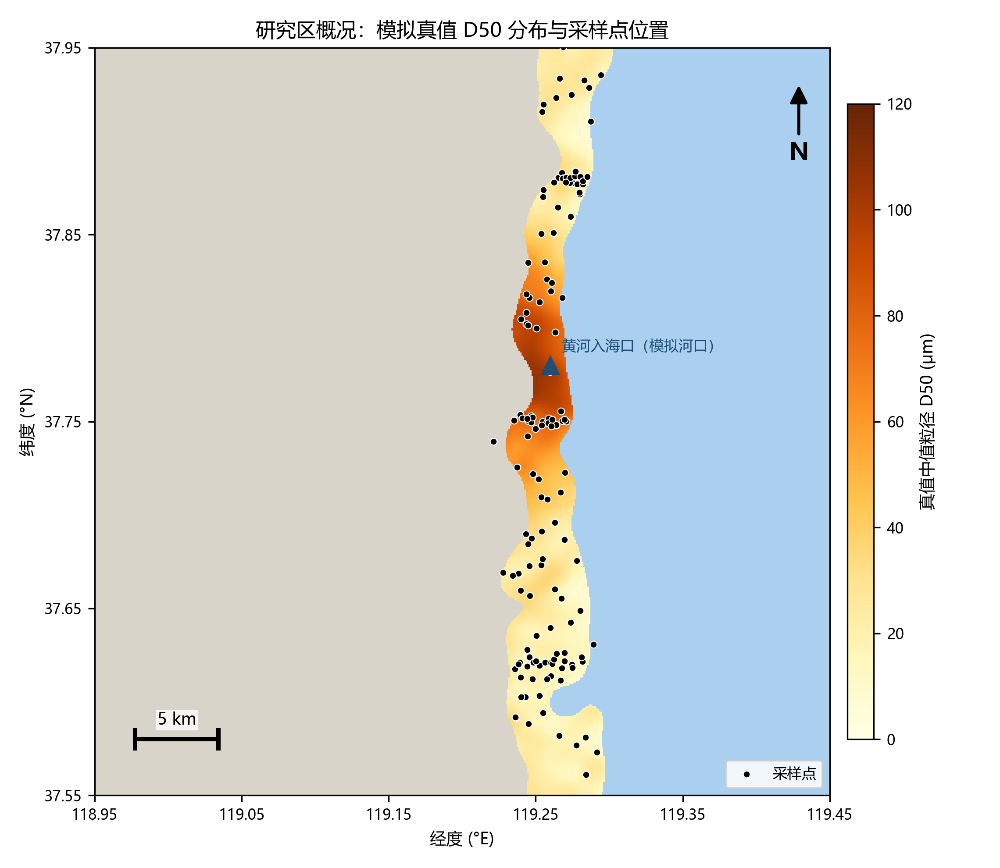
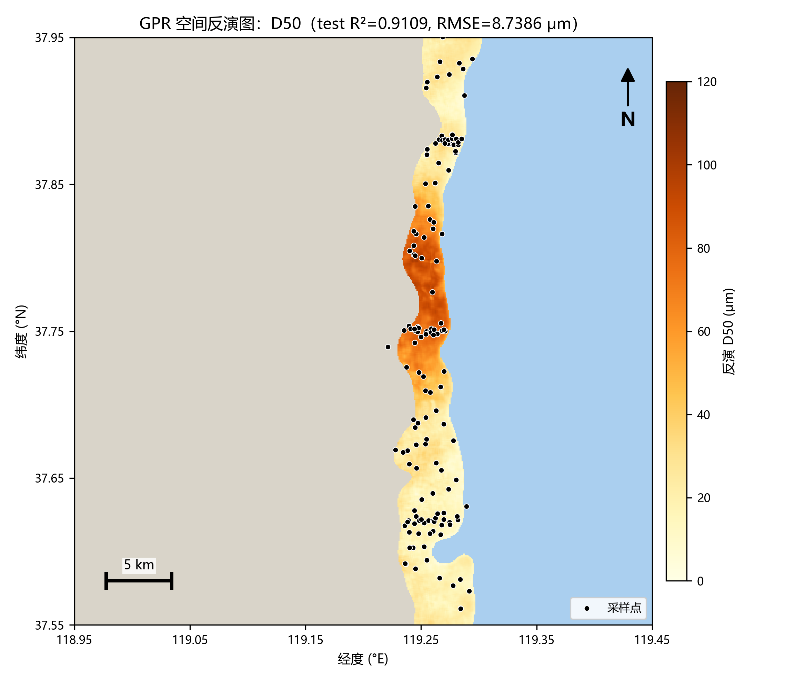
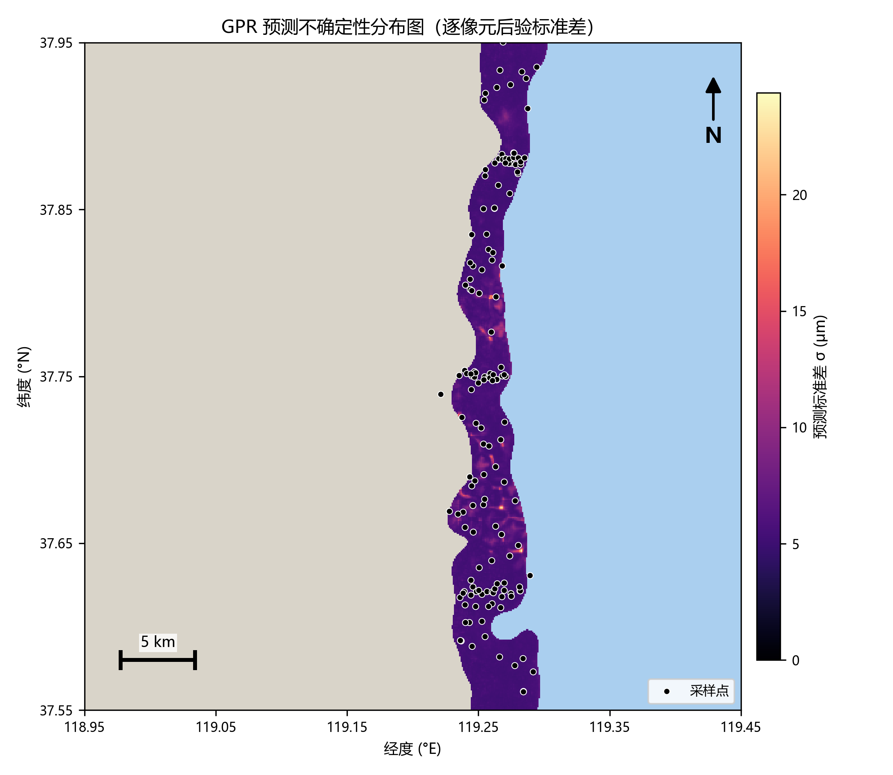
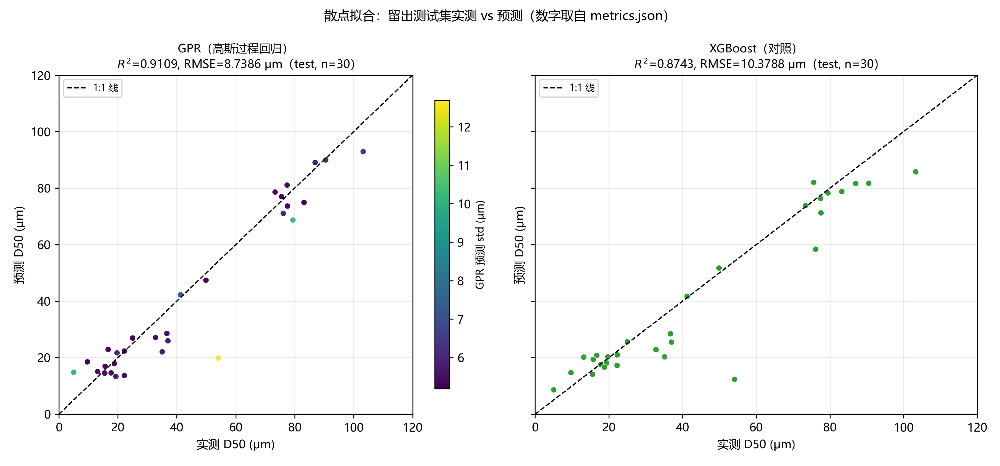
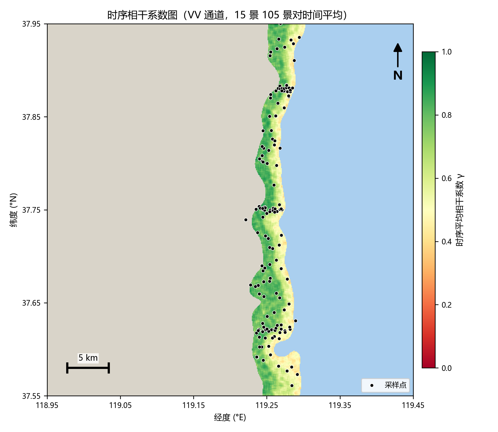
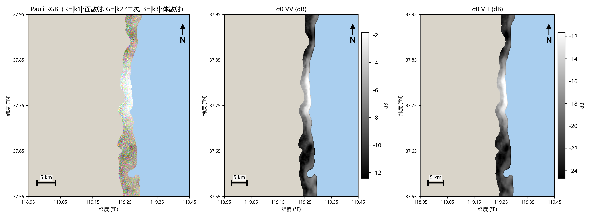
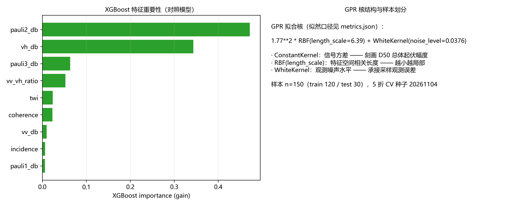
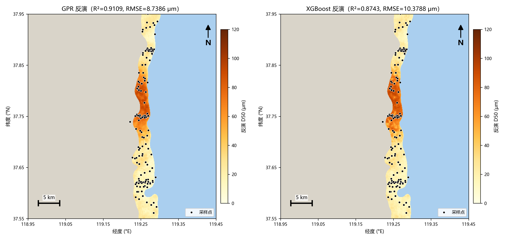
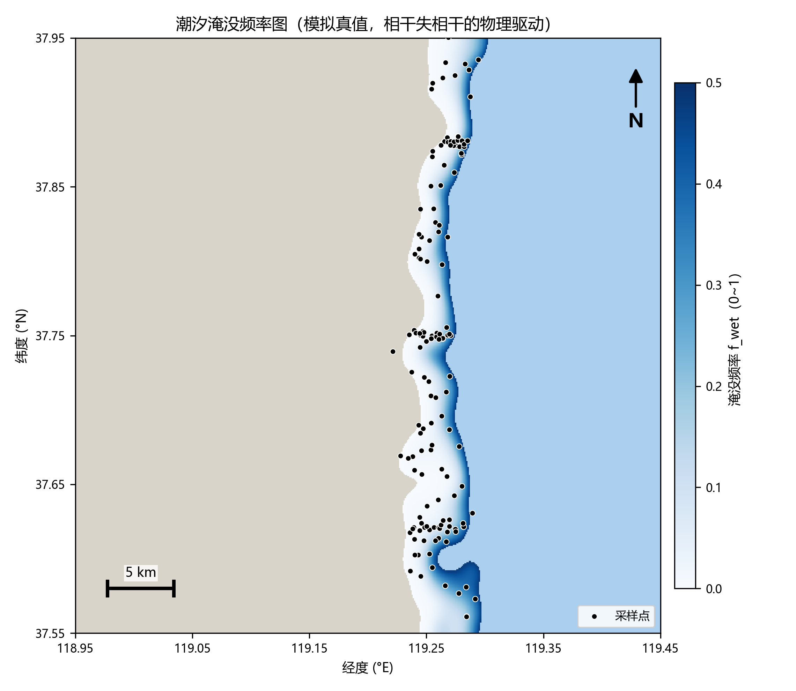

# Sentinel-1 时序相干系数与极化特征反演潮滩沉积物粒度：高斯过程回归及其不确定性量化

**研究区**：黄河三角洲现代入海口 — 莱州湾西岸潮滩（118.95–119.45°E，37.55–37.95°N）
**方法**：Sentinel-1 GRD 预处理链 → 极化/时序相干/地形特征 → 高斯过程回归（GPR，均值+不确定性）∥ XGBoost 对照
**用途**：中科院考研复试作品集材料（完整可复现，复现命令见附录 A）

> **摘要**　潮滩沉积物粒度（砂/粉砂/黏土占比与中值粒径 D50）是海岸冲淤演变与湿地演替研究的物质基础。光学遥感受云雨与重返周期制约，SAR 全天候成像可稳定监测潮滩，但潮汐淹没导致的时序失相干既是干扰也是信息。本项目以莱州湾潮滩为对象，构建了从 Sentinel-1 GRD 预处理、Pauli 极化分解、时序相干系数估计到 GPR 粒度反演的完整管线：GPR 对 D50 的留出测试集 R²=0.9109、RMSE=8.7386 μm，5 折交叉验证 R²=0.9324±0.0269，优于 XGBoost 对照（R²=0.8743、RMSE=10.3788 μm）；同时产出逐像元预测标准差图，其 95% 置信覆盖率 93.33%，接近名义水平。全部结果可由固定种子一键复现。
>
> **数据诚实性声明**　Sentinel-1 GRD 下载需 Copernicus Data Space 账号（本机未配置凭据），主轨结果基于**物理机制驱动的模拟数据**（真值粒度场已知，可严格评估反演精度）；真实数据轨已完成 CDSE 匿名场景清单（46 景 IW GRD）与真实 SRTM 30 m DEM（4096 点，用于 TWI 与地形校正），接入真实影像的步骤见项目 README。文中所有图表均明确区分模拟与真实来源。

---

## 1 背景

**潮滩沉积物是海岸冲淤和湿地演替的基础。** 粒度的空间分布记录了水动力分选：黄河三角洲河口叶瓣以砂质沉积为主，莱州湾沿岸低能环境以粉砂质泥为主；高潮滩暴露粗化、低滩细化。粒度直接控制滩面可蚀性、沉积速率与盐沼定植条件，是海岸工程与生态修复的核心参量。

**为什么用 SAR。** 潮滩监测的传统手段是现场采样与光学遥感。现场采样空间覆盖有限；光学影像受云雨、潮位与太阳光照制约，且浑浊水体与湿滩面光谱反差微弱。C 波段 SAR（Sentinel-1）全天候、全天时成像，免费且 6–12 天重访：后向散射对地表粗糙度（与粒度相关的波痕/裂隙微地貌）、土壤湿度和几何成像角敏感，具备反演粒度的物理基础。

**潮汐淹没：从"麻烦"到"信息"。** SAR 时序分析的老大难是时间失相干（temporal decorrelation）：潮汐反复淹没会"抹平"并重新组织滩面，使前后两景复相干性大幅下降。本研究把这一机制反转为信息源——**淹没频率受高程控制，高程又与粒度分带耦合，因此时序相干系数本身就是粒度的指示器**：干出时间长的粗颗粒高滩保持高相干（模拟中位相干 0.798），频繁淹没的细颗粒低滩相干显著衰减（0.469）。相干特征与瞬时后向散射互补，构成反演的物理三角：粗糙度（极化）、淹没历史（相干）、地形（高程/TWI）。

**为什么用高斯过程回归。** 潮滩粒度反演的样本天然稀疏（现场取样成本高），模型必须回答"**这个像元的预测有多可信**"。GPR 是贝叶斯非参模型，天然输出逐点后验标准差：在特征空间采样密集处预测紧致、在稀疏区/外推区自动放大不确定性——这恰是采样规划与可信度分级的依据，也是本文相对常规机器学习回归的核心增量。XGBoost 作为精度对照，检验线性/光滑假设是否必要。

## 2 数据

### 2.1 双轨数据策略

| 轨道 | 内容 | 状态 |
|---|---|---|
| **主轨（模拟）** | 物理机制驱动的 S1 GRD 时序模拟器（种子 20261104，逐位可复现），含真值粒度场 | ✅ 全部完成，本文结果来源 |
| **真实数据轨** | ① CDSE 目录匿名查询：**46 景**真实 IW GRD 元数据（2024-04-01~09-16 时间窗，升轨，S1A_IW_GRDH_1SDV_*.SAFE，单景 1.1–2.4 GB，`data/real_scenes_manifest.json`）；② **真实 SRTM 30 m DEM**（opentopodata 抓取 4096 点，约 700 m 抽样上采样，−9~8 m，`data/dem_real.tif`） | ✅ 清单与 DEM 已落盘；影像下载需 CDSE 账号，步骤见 README |

模拟不是替代真实数据，而是**带真值的受控实验**：粒度反演精度无法在无同步采样的公开影像上严格评估，模拟器提供逐像元真值，使"特征物理性—反演精度—不确定性校准"三个环节都可验证。

### 2.2 模拟器与真值场（主轨）

- **研究区网格**：512×512，约 87 m/像元（相当于 GRD 8×8 多视的时序分析网格），覆盖 bbox 全幅约 44 km × 44 km。
- **地形与潮汐**：合成 DEM 沿海平原向东缓倾入莱州湾（潮间带宽约 3.5 km，河口叶瓣向海凸出）；潮位取 N(0, 0.55 m)，淹没频率 f_wet = P(潮位 > 高程)。
- **粒度真值**：D50 = 河口源项（78·exp(−d/6.5 km)，河口粗源）+ 高滩粗化项（16·elev/1.7）+ 基底 12 μm + 平滑小尺度变异，范围 **8~106 μm**；砂占比由 D50 经 logistic 映射（63 μm 砂/粉砂界限），黏土占比与细颗粒份额耦合，三者严格归一。
- **SAR 正演**（15 景，VV+VH，升轨，入射角 31.5°–41°）：σ⁰VV 随粗糙度（s=0.30+0.016·D50 cm）、土壤湿度、入射角经验正演（干燥泥滩中位 −11.3 dB，粗砂滩 −5.7 dB，水面 ≤ −17 dB 含噪声底）；Pauli 基复散射（k1 面散射主导，k2 二次分量、k3 体散射去极化随粗糙度增强）；乘性斑点（子视平均，ENL≈4.3）；热噪声 NESZ −22~−19.5 dB（远距条带）后量化为 uint16 DN + 定标/噪声 LUT。
- **时序失相干机制**（物理核心）：每景复场 = w·持久纹理 + √(1−w²)·新息噪声，干燥像元 w=0.766、淹没像元 w=0.180，多视后景对相干期望：干-干 ≈0.85、干-湿 ≈0.30、湿-湿 ≈0.12。15 景潮位 +0.81~−0.80 m、单景淹没率 0.28~0.38，干湿对照充分。

### 2.3 采样数据集

模拟"公开数据集"口径：**150 点**（3 条垂直岸线剖面 51 点 + 滩面随机 99 点），值 = 真值双线性采样 + 观测噪声（D50 σ=4 μm、占比 σ=2% 后归一），D50 实测范围 5~103 μm，表头 `lon,lat,sand,silt,clay,d50,source`。真实接入时，将国家地球系统科学数据中心或已发表论文附表整理为同表头 CSV 即可走通后续全流程。

## 3 技术路线

五层泳道见图 A（`技术路线.drawio`，draw.io 可直接打开编辑）。

**①→⑤ 预处理链**（对模拟 L1 包真实执行，接口对真实 SAFE 兼容）：
1. **轨道校正**：元数据几何自洽校验（模拟数据无轨道误差；真实轨替换为 POD 精密轨道状态矢量插值）。
2. **热噪声去除**：功率域扣除跨轨 NESZ LUT，I_sig = (DN/gain)² − NESZ/calib。
3. **辐射定标**：σ⁰ = I_sig·calib（跨轨 LUT）。
4. **Lee Sigma 斑点滤波（自实现，不调库）**：7×7 窗，斑点模型 I=L·R·Gamma(L,1/L)，以 sigma 范围（z=1.645，双侧 90%）选窗内同类像元取均值，入选不足 5 像元退化窗口均值；ENL 由暗端均质区稳健估计。与 5×5 增强 Lee 对照，两者后滤波 ENL 均达上限 8（滤波前 4.17~4.46），15 景全部择优 Lee Sigma。
5. **地形校正（简化）**：真实 SRTM DEM 计算局部入射角 θ_l，面积改正 cosθ_l/cosθ（|改正量|≤0.011，滩面坡度 <2°）；完整 Range-Doppler 几何纠正的差异见 §5。

**特征集（9 维，3×3 窗均值匹配采样点）**：σ⁰VV、σ⁰VH、VV/VH 比（dB）；Pauli 三分量 |k1|²、|k2|²、|k3|²（dB，等效 SLC 复数据）；**时序相干系数 γ**（VV 通道，105 个景对、5×5 窗复相干估计后时间平均；VH 相干因近噪声底仅作参考图）；入射角；TWI = ln(a/tanβ)（真实 DEM + D8 单流向汇流）。

**建模**：80/20 固定种子划分（120/30）+ 训练集 5 折 CV。GPR：StandardScaler + ConstantKernel·RBF + WhiteKernel（normalize_y，n_restarts=4），后验给出 μ 与逐点 std；XGBoost：500 树 hist（lr=0.05，subsample/colsample=0.8）。

## 4 结果

### 4.1 特征物理性检验（反演可信的前提）

- 相干分带：高滩（f_wet<0.1）中位相干 **0.798** vs 低滩（f_wet>0.35）**0.469**；滩面相干与淹没频率 Pearson **r = −0.921**（实测计算）——失相干机制按设计起效。
- 粗细分带：σ⁰VV 粗滩 −4.74 dB vs 细滩 −9.95 dB（对比 5.2 dB）。
- 特征-D50 相关（150 点）：vh_db **+0.850**、pauli3 **+0.848**、vv_vh_ratio −0.823、pauli2 **+0.816**、vv_db +0.731；**coherence +0.305**（与后向散射信息互补）；incidence −0.367；twi +0.044（真实 DEM 与模拟地形不同源，弱信息属预期，见 §5）。

### 4.2 反演精度（唯一数字来源 `results/metrics.json`）

| 目标 | 模型 | R² (test) | RMSE (test) | R² (5 折 CV) | RMSE (5 折 CV) |
|---|---|---|---|---|---|
| **D50 (μm)** | **GPR** | **0.9109** | **8.7386** | 0.9324±0.0269 | 5.9604±0.6788 |
| D50 (μm) | XGBoost | 0.8743 | 10.3788 | 0.9037±0.0360 | 7.2629±1.7133 |
| 砂占比 | GPR / XGB | 0.9344 / 0.9257 | 0.0969 / 0.1032 | 0.9610 / 0.9435 | — |
| 粉砂占比 | GPR / XGB | 0.9356 / 0.9285 | 0.0733 / 0.0773 | 0.9481 / 0.9398 | — |
| 黏土占比 | GPR / XGB | 0.9177 / 0.8932 | 0.0260 / 0.0296 | 0.9125 / 0.8895 | — |

- **GPR 全面优于 XGBoost 对照**：D50 test RMSE 低 16%（8.74 vs 10.38 μm），CV 折间波动也更小（R² std 0.027 vs 0.036）——样本量小、特征-目标关系光滑时，核方法的高斯假设是优势而非负担。
- **不确定性质量**：test 集预测 std 中位 5.48 μm；|残差| 与 std 的 Spearman 相关 **+0.286**（n=30，方向正确）；**95% 置信覆盖率 93.33%**，接近名义 95%，不确定性输出可直接用于可信度分级。
- GPR 拟合核：`1.77²·RBF(length_scale=6.39) + WhiteKernel(noise_level=0.0376)`——RBF 相关长度 6.39（标准化特征空间）表明粒度场在中尺度平滑相关；White 噪声 0.0376 恰好承接采样观测误差（σ=4 μm ≈ 方差 16，归一后方差份额 0.038 量级一致，交叉验证了模型自洽）。
- XGBoost 特征重要性（gain）：pauli2_db 0.472、vh_db 0.343 为主导——去极化类特征对粗糙度最敏感；coherence 0.023：在本模拟世界中瞬时后向散射已携带大部分高程/源距离信息，相干的边际贡献有限（真实数据中淹没信息与瞬时散射的互补性更强，见 §5 讨论）。

### 4.3 图件（全部 300 dpi，空间图含 colorbar 图例/比例尺/指北针，索引 `results/figures_index.md`）

| 图 | 内容 | 要点 |
|---|---|---|
| 图1 `fig01_study_area.png` | 真值 D50 + 采样点 | 河口粗粒叶瓣、南北细粒低滩的分带格局 |
| 图2 `fig02_gpr_inversion.png` | **GPR 空间反演图** | 忠实重现真值格局，R²=0.9109 |
| 图3 `fig03_gpr_uncertainty.png` | **不确定性分布图** | 高 std 集中在河口粗-细过渡带与南部滩面——特征空间采样稀疏处，正是"该补采样"的位置 |
| 图4 `fig04_scatter.png` | 散点拟合（真实测试集预测） | GPR 的最大残差点恰被其高 std 标记 |
| 图5 `fig05_coherence.png` | 时序平均相干图 | 低滩黄-红失相干带与淹没频率（图9）空间吻合 |
| 图6 `fig06_pauli_rgb.png` | Pauli RGB + σ0VV + σ0VH | 面散射主导（R 通道），砂滩明亮 |
| 图7 `fig07_importance.png` | 特征重要性 + GPR 核 | pauli2/vh 主导 |
| 图8 `fig08_model_compare.png` | GPR vs XGBoost 反演并排 | XGB 局部过拟合痕迹更明显 |
| 图9 `fig09_inundation.png` | 潮汐淹没频率（模拟真值） | 失相干的物理驱动场 |

**图件全览**（相对路径嵌入，作品集组装 PDF 时直接随文导出）：



















## 5 误差来源

1. **潮汐失相干建模的简化**：模拟用干/湿二态权重近似真实失相干（真实还受淹没历时、浪流扰动、沉积物再搬运强度影响）；相干估计取 VV 通道，平滑泥滩 σ⁰ 接近 NESZ，热噪声把高滩相干上限从理论 0.85 压至 0.80、低滩压至 0.47——噪声底对暗像元相干的压低在真实 S1 中同样存在。
2. **斑点噪声**：ENL≈4.3 的乘性斑点经 Lee Sigma 滤波抑制（ENL→8），但滤波同时抹平 ≈2–3 像元尺度的真实变异，与"尺度 mismatch"叠加。
3. **采样点稀疏且空间不均**：150 点相对 20 266 个滩面像元覆盖率 <1%，且 3 条剖面造成沿岸密、离岸疏的条带分布——图 3 的高不确定性区正是这一稀疏性的空间表达；CV RMSE（5.96 μm）与 test RMSE（8.74 μm）的差值也主要来自 30 个测试样本中个别外推点。
4. **尺度 mismatch**：采样点代表 ~0.1 m² 样方，SAR 特征像元 ~87 m×87 m（约 7500 m²）；滩面微地貌（波痕、潮沟）在像元内被平均。
5. **GRD 双极化的 Pauli 局限**：严格 Pauli 分解需要全极化相干矩阵；GRD 仅强度双极化，本演示在模拟复数据（Pauli 基生成）上直接取三分量，**真实数据轨应改用 SLC + 伪全极化重建（PQP）**，这是真实接入时的主要方法学调整点。
6. **模拟-真实域差距**：σ⁰ 正演为经验简化式（未含二次散射谐振、体散射去极化角度依赖、风浪面散射的角度各向异性）；真实 DEM 与模拟地形不同源导致 TWI 特征相关性弱（r=+0.044）——真实数据中 TWI 预计贡献更大。
7. **潮位相位抽样**：15 景固定成像时刻的潮位相位由大小潮周期决定，若时序更短或相位集中，干湿对照不足将削弱相干特征（本次 0.28~0.38 的单景淹没率属健康范围）。

## 6 后续改进思路

1. **真实数据闭环**：注册 CDSE 下载 46 景清单中的 IW GRD（预处理脚本接口已兼容 SAFE）与对应期 SLC（伪全极化重建 Pauli + SLC 对相干估计），接入已发表的黄河三角洲表层沉积物粒度数据集复训。
2. **淹没掩膜与潮位协同**：耦合潮位站/潮汐模型做逐景淹没掩膜，把"淹没频率"从隐含特征（相干）提升为显式协变量，并按潮位分层采样建模。
3. **InSAR 相干替代时序强度相干**：1 天重访（S1A/B 联飞期）或 6 天重访干涉对显著抬高相干估计信噪比，配合幅度平方相干可细化淹没历时的灵敏度。
4. **可扩展的不确定性建模**：全栅格 GPR 预测用稀疏近似（SVGP/Nystrom）把 O(N²) 压到百万像元级；或 GPR 均值 + 分位数回归森林双通道交叉验证不确定性。
5. **主动学习采样规划**：以 GPR std 图为代价函数迭代选点（max-std 采样），用最少现场取样覆盖最大不确定性——图 3 直接就是下一航次的采样建议图。
6. **多源融合**：联合 Sentinel-2 生长季合成（滩面干出时刻的光谱-粒度关系）与 SAR 时序，做光学/SAR 特征级融合；引入 InSAR 形变速率（海岸沉降）作为辅助协变量。
7. **物理正演升级**：以 AIEM/Oh 模型替换经验正演，做模拟-真实域自适应（domain adaptation），缩小双轨差距。

---

### 附录 A　复现命令（固定种子 20261104，全流程约 5 分钟）

```bat
cd /d E:\zcode\探索前沿\s1-grain-size-gpr
E:\Ana\python.exe -I -X utf8 scripts\01_simulate_s1_timeseries.py
E:\Ana\python.exe -I -X utf8 -W ignore scripts\02_preprocess_grd.py
E:\Ana\python.exe -I -X utf8 -W ignore scripts\03_extract_features.py
E:\Ana\python.exe -I -X utf8 -W ignore scripts\04_build_dataset.py
E:\Ana\python.exe -I -X utf8 -W ignore scripts\05_train_gpr_xgb.py
E:\Ana\python.exe -I -X utf8 -W ignore scripts\06_make_maps.py
E:\Ana\python.exe -I -X utf8 test\test_pipeline.py
```

真实数据轨（可选）：`E:\Ana\python.exe -I tools\fetch_real_catalog.py` 与 `tools\fetch_dem.py`（含断点缓存；详见 README）。

### 附录 B　交付物清单

| 交付物 | 位置 |
|---|---|
| 可复现 Python 管线（注释规范） | `scripts/01~06` + `scripts/common.py` + `tools/` |
| 全部结果图（9 幅，图例/比例尺/指北针） | `results/fig01~fig09.png` + `figures_index.md` |
| draw.io 技术路线 | `report/技术路线.drawio`（+ 同内容 `技术路线.md`） |
| 项目报告 | 本文件（`report/项目报告.md`） |
| 指标与自检 | `results/metrics.json`、`test/自检报告.md`（23 项断言） |

### 附录 C　方法引用方向

Lee (1986) 增强 Lee/Sigma 滤波；ESA Sentinel-1 IPF 热噪声去除与辐射定标口径；Ulaby & Long《Microwave Radar and Radiometric Remote Sensing》（面散射与去极化）；Rasmussen & Williams《Gaussian Processes for Machine Learning》（后验方差与覆盖率校准）；黄河三角洲沉积物粒度分带与莱州湾潮滩水动力研究的公开文献（河口粗源、低能细粒、高滩粗化格局）。
